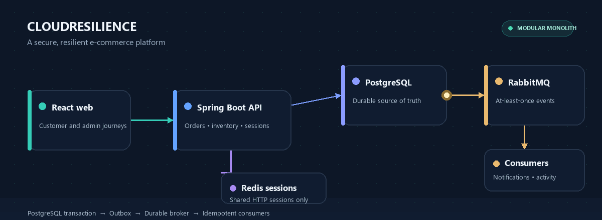
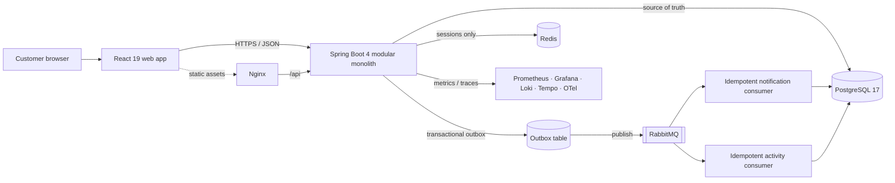

<div align="center">
  
</div>

<h1 align="center">CloudResilience</h1>

<p align="center">
  <strong>A secure, cost-conscious e-commerce platform and cloud resilience engineering project.</strong><br>
  Event-driven by design. Recovery-tested in CI. Built as a modular monolith, not a premature microservice estate.
</p>

<div align="center">

[](https://github.com/karkalashivareddy/KLH_CSE_Y25_2026-27_CDIS_S3_Team-9/actions/workflows/ci.yml)


[Repository dashboard](#repository-dashboard) · [Architecture](#architecture) · [Capabilities](#capabilities) · [Quick start](#quick-start) · [Documentation](#documentation) · [Team](#team) · [Engineering handoff](PROJECT_COMPLETION_REPORT.md)

</div>

> **Project status — honest by default.** Phases 1–8 are implemented and validated. Phases 9–10 remain in progress: recovery has been demonstrated on a synthetic order in an isolated database, but production RTO/RPO, dependency-failure drills, and final security validation are still open. No AWS resources are provisioned and no production operation is claimed. The live CI badge above is the source of truth for the current commit. See the [project handoff](PROJECT_COMPLETION_REPORT.md) and [validation matrix](docs/09-testing/FINAL_VALIDATION_MATRIX.md).

<details>
<summary><strong>Table of contents</strong></summary>

- [Repository dashboard](#repository-dashboard)
- [Architecture](#architecture)
- [Status snapshot](#status-snapshot)
- [Capabilities](#capabilities)
- [Quick start](#quick-start)
- [Repository map](#repository-map)
- [Documentation](#documentation)
- [Team](#team)
- [Engineering and security](#engineering-and-security)
- [License](#license)

</details>

## Repository dashboard

<p align="center">
  
</p>

<table>
  <tr>
    <td width="50%" valign="top">
      
    </td>
    <td width="50%" valign="top">
      
    </td>
  </tr>
</table>

| Signal | Live badge | Signal | Live badge |
|---|---|---|---|
| CI pipeline | [](https://github.com/karkalashivareddy/KLH_CSE_Y25_2026-27_CDIS_S3_Team-9/actions/workflows/ci.yml) | Last commit |  |
| Commit activity |  | Contributors |  |
| Stars |  | Forks |  |
| Issues |  | Pull requests |  |
| Repository size |  | Primary language |  |
| Security policy | [](SECURITY.md) | License |  |

<p align="center">
  
</p>

### Automated engineering gates

| Gate | Tooling | Evidence |
|---|---|---|
| Secret history | Gitleaks | Full-history scan on every push |
| Web quality | ESLint, TypeScript, Vitest, Vite | Lint, typecheck, unit tests, production build |
| API quality | Maven, JUnit, Testcontainers, PostgreSQL | Unit and integration verification |
| Container security | Trivy | HIGH and CRITICAL OS/library findings fail the build |
| Infrastructure | Terraform, TFLint, Checkov | Format, backend-free init, validate, lint and IaC scan |
| Browser journeys | Playwright | Shopper, checkout and insufficient-stock flows |
| Recovery | PostgreSQL restore drill | Isolated order/payment recovery plus API smoke |
| Runtime web security | Nginx headers, OWASP ZAP | CSP and browser-hardening headers, passive baseline scan |

## Architecture

<p align="center">
  
</p>



The system deliberately starts as a **modular monolith**. PostgreSQL is the source of truth, checkout writes business state and an outbox record in one transaction, and RabbitMQ provides at-least-once delivery to idempotent consumers. Redis is used for shared sessions, not as a cart or catalog database. The AWS Terraform in this repository is statically validated only; it is not an applied or operated cloud environment.

## Status snapshot

| Area | State |
|---|---|
| Phases | 1–8 implemented; Phases 9–10 in progress |
| Architecture | Spring Boot modular monolith; React web app |
| Data and events | PostgreSQL source of truth; transactional outbox; RabbitMQ at-least-once delivery; Redis sessions only |
| Cloud | AWS Terraform implemented and statically validated; no cloud resources deployed |
| Recovery | CI restored a synthetic order/payment into an isolated database; actual RTO/RPO not measured |
| Open gates | Final security validation, dependency-failure drills, monthly cloud estimates, and a high-severity development-toolchain advisory |

The latest hosted evidence lives in the [CI workflow](https://github.com/karkalashivareddy/KLH_CSE_Y25_2026-27_CDIS_S3_Team-9/actions/workflows/ci.yml), [final validation matrix](docs/09-testing/FINAL_VALIDATION_MATRIX.md), and [project handoff](PROJECT_COMPLETION_REPORT.md). A passing workflow is evidence for the checks it actually runs; it is not a production certification.

## Capabilities

| Capability | State |
|---|---|
| Repository and Phase 1 engineering foundations | Implemented; hosted CI runs on `main` |
| Web foundation and customer authentication UI | Implemented; frontend checks pass |
| API health, registration, sessions and authorization | Implemented; unit and PostgreSQL Testcontainers integration tests pass |
| PostgreSQL schema and Flyway migration | Implemented and verified against PostgreSQL 17.7 |
| Product catalog and categories | Implemented in V2; public search/filter/pagination and admin management are API-backed |
| Inventory adjustment, reservation and movement ledger | Implemented with transactional PostgreSQL row locks; concurrent final-unit integration test passes |
| Redis integration | Phase 4: shared Spring Session backend; not a cart/cache store |
| Customer shopping cart | Phase 4 implementation present; PostgreSQL/Redis integration tests pass |
| Orders and checkout | Phase 5: cart-asserted checkout, snapshots, atomic inventory reservation, customer idempotency, state history and order APIs/UI |
| Event-driven order processing | Phase 6: transactional outbox, versioned events, RabbitMQ retry/DLQ topology, idempotent notification/activity consumers, operator replay APIs |
| Observability | Phase 7 local profile: Prometheus, Grafana, Loki, Tempo, OpenTelemetry Collector and Alloy; metrics scrape and traces verified locally, with a bounded catalog load test |
| AWS infrastructure | Phase 8 Terraform source validated locally and by hosted CI; no AWS resources provisioned |
| Disaster recovery | Empty-state and synthetic catalog/inventory restores passed locally; hosted isolated order/payment restore and API smoke passed; RTO/RPO remain unmeasured |
| E2E test setup | Hosted Playwright registration/catalog/cart/checkout and insufficient-stock journeys passed 3/3 using a synthetic fixture |
| Simulated payments | Deterministic simulator only; no real provider, payment data, or charges |
| Order and event runtime verification | Phase 6 regression suite passed 64 tests; Phase 7 full backend suite passed 66 tests, 0 skipped |
| AWS/Azure/GCP provisioning | Not started; no resources authorized or deployed |
| Automatic reservation expiry, remote payment provider and recovery automation | Not implemented; payment simulator only |

See [project handoff](PROJECT_COMPLETION_REPORT.md), [Phase 1 closure](docs/reports/PHASE_1_CLOSURE_VERIFICATION.md), [Phase 2 implementation report](docs/reports/PHASE_2_IMPLEMENTATION_REPORT.md), [Phase 3 implementation report](docs/reports/PHASE_3_IMPLEMENTATION_REPORT.md), [Phase 4 implementation report](docs/reports/PHASE_4_IMPLEMENTATION_REPORT.md), [Phase 5 implementation report](docs/reports/PHASE_5_IMPLEMENTATION_REPORT.md), [Phase 6 implementation report](docs/reports/PHASE_6_IMPLEMENTATION_REPORT.md), [Phase 8 implementation report](docs/reports/PHASE_8_IMPLEMENTATION_REPORT.md), [Phase 9 implementation report](docs/reports/PHASE_9_IMPLEMENTATION_REPORT.md), [Phase 10 implementation report](docs/reports/PHASE_10_IMPLEMENTATION_REPORT.md), [AWS deployment guide](docs/10-deployment/AWS_DEPLOYMENT_GUIDE.md), [event-driven architecture](docs/03-architecture/EVENT_DRIVEN_ARCHITECTURE.md), [DR restore runbook](docs/07-disaster-recovery/RESTORE_RUNBOOK.md), [multi-cloud architecture comparison](docs/03-architecture/MULTI_CLOUD_PORTABILITY.md), and [multi-cloud cost estimate worksheet](docs/08-finops/MULTI_CLOUD_COST_COMPARISON.md) for evidence and scope.

## Quick start

Prerequisites and exact commands are maintained in [Local development](docs/10-deployment/LOCAL_DEVELOPMENT.md). The frontend requires Node.js 24 LTS and npm. The backend requires Java 25 and Maven 3.9.9+. Docker Desktop is needed for Compose, the web container and Testcontainers.

```powershell
Copy-Item .env.example .env
docker compose up --build
```

```bash
cp .env.example .env
docker compose up --build
```

Useful local endpoints after Compose starts:

| Surface | URL |
|---|---|
| Web application | `http://localhost:8080` |
| API health | `http://localhost:8081/actuator/health` |
| Grafana | `http://localhost:3000` |
| Prometheus | `http://localhost:9090` |

Do not treat a command as verified unless the validation report records its result. A Compose setup is not a cloud deployment. Never commit `.env` or real credentials.

## Repository map

```text
apps/web/                 React + TypeScript frontend
apps/api/                 Spring Boot modular-monolith API
services/                 Future worker boundaries (not implemented)
packages/                 Future shared contracts (not implemented)
infrastructure/           Terraform modules and local recovery scripts
platform/                 Local/container/observability tooling
docs/                     Product, architecture, security, testing, operations
tests/                    Cross-application tests (as introduced)
.github/workflows/        CI checks; no cloud credentials
```

## Documentation

<details open>
<summary><strong>Product, architecture and delivery</strong></summary>

- [Project charter](docs/01-project-overview/PROJECT_CHARTER.md)
- [Requirements](docs/02-requirements/REQUIREMENTS_SPECIFICATION.md)
- [System architecture](docs/03-architecture/SYSTEM_ARCHITECTURE.md)
- [Final system architecture](docs/03-architecture/FINAL_SYSTEM_ARCHITECTURE.md)
- [Architecture decisions](docs/04-architecture-decisions/)
- [Event-driven architecture](docs/03-architecture/EVENT_DRIVEN_ARCHITECTURE.md)
- [Event catalog](docs/03-architecture/EVENT_CATALOG.md)
- [Catalog and inventory design](docs/03-architecture/CATALOG_INVENTORY_DESIGN.md)
- [Distributed sessions and cart design](docs/03-architecture/DISTRIBUTED_STATE_CART_DESIGN.md)
- [Order and checkout design](docs/03-architecture/ORDER_CHECKOUT_DESIGN.md)
- [Identity schema](docs/03-architecture/IDENTITY_SCHEMA.md)
- [Multi-cloud architecture comparison](docs/03-architecture/MULTI_CLOUD_PORTABILITY.md)

</details>

<details open>
<summary><strong>Security, observability and testing</strong></summary>

- [Security and threat model](docs/05-security/SECURITY_ARCHITECTURE.md)
- [Authentication and sessions](docs/05-security/AUTHENTICATION_AND_SESSIONS.md)
- [Observability architecture](docs/03-architecture/OBSERVABILITY_ARCHITECTURE.md)
- [SLO/SLI definitions](docs/07-observability/SLO_SLI_DEFINITIONS.md)
- [Alerting runbook](docs/07-observability/ALERTING_RUNBOOK.md)
- [Dashboard catalog](docs/07-observability/DASHBOARD_CATALOG.md)
- [Load-test results](docs/07-observability/LOAD_TEST_RESULTS.md)
- [Testing strategy](docs/09-testing/TEST_STRATEGY.md)
- [Final validation matrix](docs/09-testing/FINAL_VALIDATION_MATRIX.md)

</details>

<details open>
<summary><strong>Deployment, recovery and operations</strong></summary>

- [Local development](docs/10-deployment/LOCAL_DEVELOPMENT.md)
- [API endpoint reference](docs/10-deployment/API_ENDPOINTS.md)
- [Toolchain versions](docs/10-deployment/TOOLCHAIN_VERSIONS.md)
- [Final deployment guide](docs/10-deployment/FINAL_DEPLOYMENT_GUIDE.md)
- [AWS deployment guide](docs/10-deployment/AWS_DEPLOYMENT_GUIDE.md)
- [DR restore runbook](docs/07-disaster-recovery/RESTORE_RUNBOOK.md)
- [Final recovery summary](docs/12-disaster-recovery/FINAL_RECOVERY_SUMMARY.md)
- [Multi-cloud cost comparison](docs/08-finops/MULTI_CLOUD_COST_COMPARISON.md)
- [Cost management strategy](docs/08-finops/COST_MANAGEMENT_STRATEGY.md)
- [Project completion handoff](PROJECT_COMPLETION_REPORT.md)
- [Team workflow](docs/11-team-workflow/BRANCHING_STRATEGY.md)

</details>

## Team

| Roll number | Name | Initial focus |
|---|---|---|
| 2520030105 | Karkala Shiva Reddy | Architecture, cloud, Terraform, DevSecOps, CI/CD, resilience, integration |
| 2520030203 | Harivikash Katta | Backend, APIs, data, distributed systems, backend testing |
| 2520030286 | Kari Prudhi Sai | Frontend, dashboard, observability UI, E2E, documentation support |

Responsibilities are collaborative; see [team responsibilities](docs/11-team-workflow/TEAM_RESPONSIBILITIES.md).

## Engineering and security

- **Secure defaults:** CSP, referrer policy, nosniff, frame denial and permissions policy are asserted against the deployable Nginx image.
- **Scan before shipping:** secret history, dependency audit, container images, Terraform and IaC are checked in CI.
- **Evidence over claims:** each validation record names the exact command, environment and result; unmeasured RTO/RPO and unrun failure drills stay open.
- **No hidden cloud spend:** no cloud resources, paid services or production deployment have been created. `.env` is ignored; `.env.example` contains local-only defaults.
- **Direct-to-main delivery:** work is integrated on `main` without pull requests for this course execution, per repository-owner direction.

Read [CONTRIBUTING.md](CONTRIBUTING.md), [SECURITY.md](SECURITY.md), and the [cost policy](docs/08-finops/COST_MANAGEMENT_STRATEGY.md) before changing the delivery or deployment posture. The known high-severity development-toolchain advisory remains documented in the [project handoff](PROJECT_COMPLETION_REPORT.md); a passing production dependency audit does not resolve it.

## License

No license is declared. All rights remain with their respective owners; do not assume reuse rights. A license should be selected by the repository maintainers before one is added.
