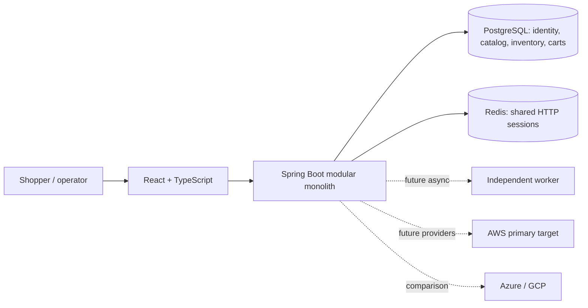

# Architecture overview

**Purpose/scope:** concise view of current and target composition. Phase 1 implements only UI shell and API health/info. See [system architecture](SYSTEM_ARCHITECTURE.md), [container](CONTAINER_ARCHITECTURE.md), [deployment](DEPLOYMENT_ARCHITECTURE.md).

The frontend reports only locally observed API health and explicitly labels unconfigured services. Cloud components in diagrams are proposed. Key decisions: modular monolith before microservices; PostgreSQL for transactions; ECS Fargate before EKS; adapter boundaries only where there is real provider variation. Risks: runtime/provider behavior needs tests, cost and recovery targets are not validated. Related ADR-001/003/005/006/007.
