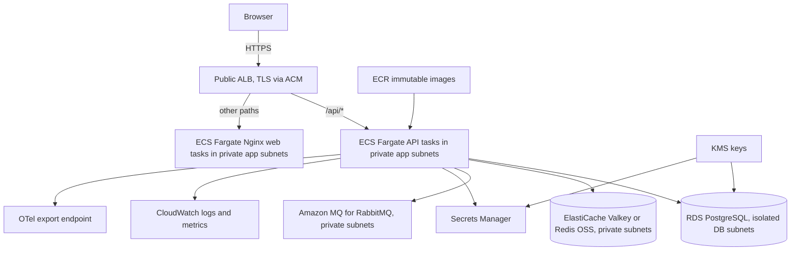

# AWS target architecture

**Status (2026-11-17):** AWS target design and Terraform source are implemented locally; hosted validation is pending. No AWS resources have been provisioned.

## Design

AWS is the single primary deployment target. The application remains a Spring Boot modular monolith; PostgreSQL is the durable business store, Redis-compatible ElastiCache is only for shared Spring Session state, and RabbitMQ remains an asynchronous transport for the existing outbox and idempotent consumers.

Terraform currently runs the built React assets in an unprivileged Nginx container on ECS. The ALB routes `/api/*` to the API and all other paths to the web service, preserving same-origin Spring Session/CSRF behavior. CloudFront with an S3 origin remains an optional future optimization, not an implemented resource. The ALB is the only internet-facing application target. API/web tasks and all data services use private address space; database subnets have no direct internet route.

| Responsibility | AWS target | Boundary and decision |
|---|---|---|
| Static React | Nginx web container on ECS Fargate behind ALB | Serves the existing Vite build; same-origin API routing preserves browser session/CSRF behavior. CloudFront/S3 is deferred. |
| API | ECS Fargate behind ALB | One modular monolith image; immutable commit-tagged image in private ECR. No EKS without a measured need. |
| Database | RDS for PostgreSQL | Durable orders, inventory, carts, outbox, inbox and identity. Private DB subnet group; encryption, backups/PITR, deletion protection and explicit maintenance settings. |
| Sessions | ElastiCache for Valkey or Redis OSS | Ephemeral shared HTTP session store only. Loss requires reauthentication; it does not lose business records. Validate Spring Data Redis/TLS and chosen engine behavior before deployment. |
| Messaging | Amazon MQ for RabbitMQ | Existing AMQP publisher/consumer ports. Confirm supported RabbitMQ version, queue types, topology, TLS, confirms, DLX/retry behavior and quotas in the selected region. AWS states Amazon MQ does not support RabbitMQ streams; the current project uses queues, not streams. |
| Secrets and keys | Secrets Manager + KMS | Inject references at task runtime; never place values in Terraform state, outputs, images or user data. |
| Telemetry | CloudWatch plus OpenTelemetry Collector/export | Keep application telemetry provider-neutral; review ingestion, retention and egress costs. |
| Network | VPC, public edge subnets, private app subnets, isolated data subnets | Narrow security-group references; VPC endpoints where their fixed cost is lower than NAT/egress. |

### Availability profiles

- **Development:** one API task and small single-AZ data services only after a budget decision. This is not an HA configuration. A development deployment should be destroyable and have explicit backup/retention limits.
- **Staging:** at least two API tasks across AZs; data-service topology and backup RPO are explicitly selected. Avoid claiming HA until the actual module inputs and service controls establish it.
- **Production-like:** ALB and Fargate tasks across at least two AZs; RDS Multi-AZ or Multi-AZ DB cluster as selected; multi-AZ cache/broker topology only after service compatibility and cost review. Cross-region recovery is a separate, priced decision.

NAT is a cost/availability trade-off: one NAT gateway lowers fixed cost but creates an AZ dependency and cross-AZ data transfer; one per AZ improves zonal independence but increases fixed cost. Prefer VPC endpoints for supported AWS service traffic where the use and pricing justify them. Do not claim NAT-free egress until the image pull, logs, secrets, metrics, package downloads and application endpoints have been enumerated.

### Readiness and deployment

Use ECS container health checks for liveness, ALB target checks for traffic readiness, and alarms for dependency health. ECS deployment circuit breaker with rollback is appropriate for rolling ECS deployments. A failed rollout must retain the last healthy task definition and provide an operator-visible signal. Database migrations run as a controlled one-off task against the same image before API rollout; migrations must remain backward-compatible across the rollout window.

## AWS support references checked 2026-11-17

- Amazon MQ engine versions and feature caveats: [RabbitMQ version management](https://docs.aws.amazon.com/amazon-mq/latest/developer-guide/rabbitmq-version-management.html), [release notes](https://docs.aws.amazon.com/amazon-mq/latest/developer-guide/amazon-mq-release-notes.html), and [regional/engine API](https://docs.aws.amazon.com/amazon-mq/latest/api-reference/broker-engine-types.html). At this check, AWS documentation recommends RabbitMQ 4.3; region and instance support must be queried before a plan.
- [ECS deployment circuit breaker](https://docs.aws.amazon.com/AmazonECS/latest/developerguide/deployment-circuit-breaker.html).
- [RDS encryption](https://docs.aws.amazon.com/AmazonRDS/latest/UserGuide/Overview.Encryption.html) and [automated backup retention](https://docs.aws.amazon.com/AmazonRDS/latest/UserGuide/USER_WorkingWithAutomatedBackups.BackupRetention.html).
- [ElastiCache TLS](https://docs.aws.amazon.com/AmazonElastiCache/latest/dg/in-transit-encryption.html) and [IAM authentication](https://docs.aws.amazon.com/AmazonElastiCache/latest/dg/auth-iam.html).

These pages establish documented service capability, not account enablement, regional availability, compatibility testing, Terraform validation, or deployment.
