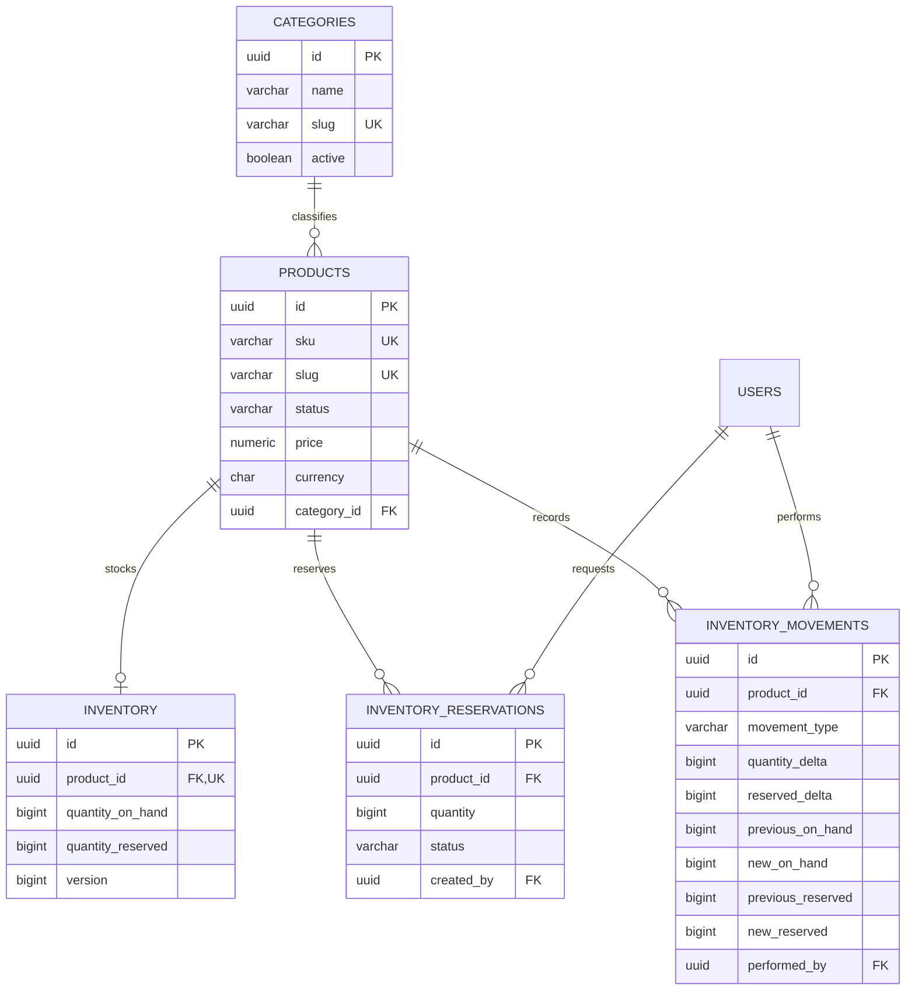

# Catalog and inventory design (Phase 3)

**Scope:** PostgreSQL-backed product/category browsing and administrator catalog/inventory operations. No cart, order, payment, customer reservation API, nested categories, currency conversion, catalog cache, cloud resource, or external search service is included.

## Model and invariants

Migration V2 is forward-only; never rewrite V1. Categories are flat and identified by unique lowercase slugs. Product SKU is normalized to uppercase and unique; slug is lowercase and unique. Price is `BigDecimal` backed by `NUMERIC(12,2)`, positive, and USD-only in this phase. Status transitions are DRAFT to ACTIVE/ARCHIVED and ACTIVE to ARCHIVED; reactivation is an explicit admin status update. Archived products are not deleted. Only ACTIVE products in active categories are returned publicly. Products with no inventory report zero available stock.

Inventory stores only on-hand and reserved quantities; availability is always derived: `on_hand - reserved`. DB checks enforce `on_hand >= 0`, `reserved >= 0`, and `reserved <= on_hand`. Each product has at most one inventory row. Inventory is PostgreSQL-authoritative; no availability cache is used.

## Transaction/concurrency contract

Inventory application service starts a database transaction and locks the inventory row with `SELECT ... FOR UPDATE` before reading quantities. Reservation then writes its lifecycle row, updates reserved quantity, appends the movement event, and commits atomically. Manual adjustments reject any result below already-reserved stock. Release locks inventory first and reservation second, only releases RESERVED once, and appends a compensating event. Failures roll back all writes. Same-product operations serialize; different product rows remain independent.

Movement fields record signed on-hand and reserved deltas and both before/after snapshots. The movement table is append-only: no update/delete API or repository operation, Hibernate immutable mapping, and a PostgreSQL trigger prevents direct mutation. Correct mistakes with new correction movements. Every authenticated ADMIN action records the actor. Phase 3 reservation/release endpoints are ADMIN-only; customer-facing cart/order reservation is deliberately deferred until those ownership and lifecycle domains exist.

## Public API contract

| Route | Access | Behavior |
|---|---|---|
| `GET /api/v1/categories` | Public | Active categories only |
| `GET /api/v1/categories/{id}` | Public | Active category or 404 |
| `GET /api/v1/products?page=0&size=20&sort=name&direction=asc&categoryId=&q=` | Public | Active products in active categories; SQL pagination; max size 100; stable sort allowlist; optional category and name/SKU substring filter |
| `GET /api/v1/products/{id}` | Public | Active product details, category, derived availability |
| `GET /api/v1/products/{id}/availability` | Public | Derived availability only; no reservation mutation |

## Administrator API contract

All routes require backend `ROLE_ADMIN`; frontend protection is UX only. Mutations require the existing session CSRF header.

| Route | Behavior |
|---|---|
| `POST /api/v1/admin/categories`, `PUT /api/v1/admin/categories/{id}` | Create/update flat category; slug unique; active controls public listing |
| `POST /api/v1/admin/products`, `PUT /api/v1/admin/products/{id}` | Create/update product in DRAFT; unique normalized SKU/slug, active category, positive USD price and HTTPS image URL |
| `PATCH /api/v1/admin/products/{id}/status` | Explicit activate/archive transition; archived records retained |
| `POST /api/v1/admin/inventory/{productId}` | Create initial inventory exactly once and append INITIAL_STOCK movement |
| `GET /api/v1/admin/inventory?page=0&size=20` and `GET /api/v1/admin/inventory/{productId}` | Paginated/all or single inventory with on-hand, reserved, derived available and history |
| `POST /api/v1/admin/inventory/{productId}/adjustments` | Signed non-zero on-hand adjustment with required reason; cannot reduce below reserved |
| `POST /api/v1/admin/inventory/{productId}/reservations` | Reserve positive quantity if available; returns reservation ID |
| `POST /api/v1/admin/inventory/{productId}/reservations/{reservationId}/release` | Release an active reservation once |

Expected statuses: 200 retrieval/update; 201 creation; 400 validation; 401 unauthenticated; 403 non-admin; 404 unknown resource; 409 uniqueness, lifecycle, or insufficient-stock conflict. Error envelope stays consistent with Phase 2 and never exposes SQL/stack details.

## Query and validation strategy

All filters are bound JPA parameters. Sorting accepts only name, SKU, price, or created time; page size is bounded. Product pages use database pagination and batch-fetch inventory for page IDs to avoid N+1 reads. Search uses case-insensitive `LIKE` on name/SKU with SQL wildcard characters escaped. No external search or catalog cache is justified at current scale.

See ADR-016 (catalog/currency), ADR-017 (row locking), ADR-018 (reservation/ledger) and `docs/10-deployment/API_ENDPOINTS.md` for the auth contract inherited from Phase 2.

## Acceptance criteria

1. Fresh PostgreSQL migration applies V1 then V2 and Hibernate validates the schema.
2. Public queries exclude draft/archived products and inactive categories; filters/sorts/page bounds behave deterministically.
3. Admin-only writes persist products/categories/adjustments; CUSTOMER/anonymous mutation calls are rejected.
4. Every inventory mutation and reservation lifecycle transition writes one matching actor-attributed movement in the same transaction; failures leave no partial state.
5. Simultaneous requests for a final unit yield exactly one success, zero negative availability, one active reservation and a consistent ledger.
6. Frontend pages display only API results with honest loading, empty and error states.
