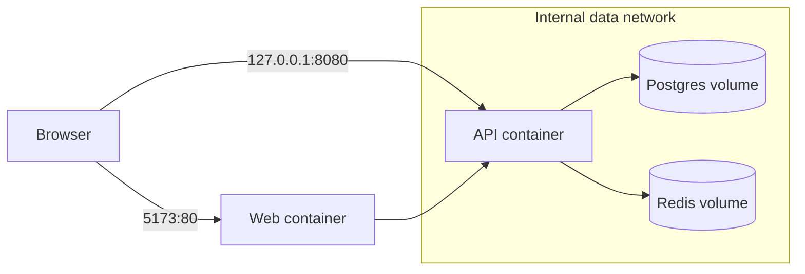

# Container architecture

**Purpose/scope:** describe app and local containers; cloud containers remain planned. `apps/web` builds static React assets served by a minimal web server. `apps/api` is a non-root Java 25 Spring Boot process. Compose includes PostgreSQL and Redis on an internal data network; DB/Redis host ports, if enabled for local developer tools, bind to `127.0.0.1` only. API receives no DB credentials until persistence is implemented.

Images are tagged, include health checks, and data uses named volumes. Local defaults are explicitly non-secret; never reuse them outside local development. Production images should be digest-pinned, scanned, signed, non-root, and deployed with resource limits and read-only filesystems where compatible. Risks: image tags may be unavailable on a host platform; test pulls/builds. Validation: `docker compose config`, image builds, container health and network inspection.
