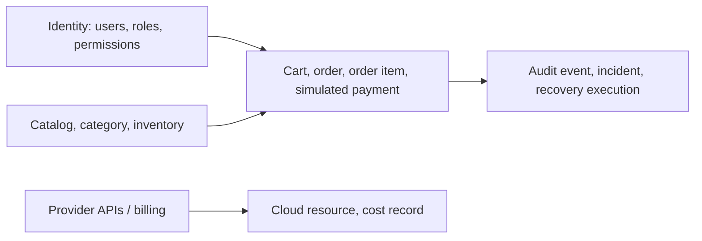

# Data architecture

**Purpose/scope:** conceptual ownership and data flow; not a Phase 1 production schema. PostgreSQL is the transactional source of truth; Redis is a rebuildable cache. See [database design](DATABASE_DESIGN.md), [ER model](ENTITY_RELATIONSHIPS.md), and security classification.

User identifiers and contact/address data are personal data; credentials are hashed (never reversible); payment uses a synthetic reference only; audit/incident records can contain operationally sensitive details; cost records may reveal account/resource identifiers. Retention periods are unapproved and must be decided against policy before deployment. Encrypt at rest/in transit, restrict access and log administrative reads/changes.

Order placement is a bounded transaction: validate and reserve inventory, snapshot price/quantity, create order and outbox record atomically. External message/payment simulation occurs after commit and is idempotent. Avoid holding DB locks during network calls. Backup/restore procedures must preserve referential integrity and be tested.
