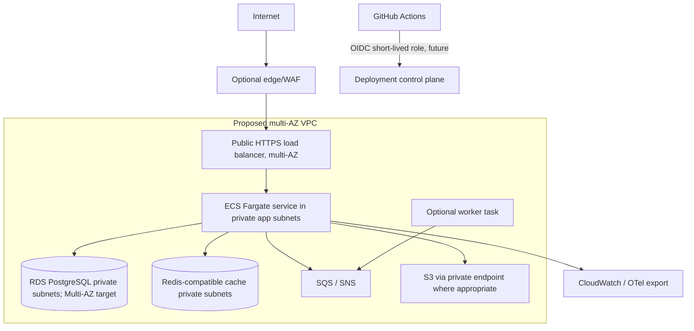

# Deployment architecture

**Purpose/scope:** proposed future AWS production shape, not deployed. Current environment is local only. See ADR-005/006/009 and network architecture.

Public entry should be limited to HTTPS edge/load balancer. Compute, databases, cache and queues have no public inbound path; outbound access is narrowly routed via NAT/endpoints. Environments are separate accounts or equivalent boundaries. DR topology is selected only after approved RTO/RPO and cost review. Validate IaC plans/policies and network reachability before deployment; require explicit authorization, budget and cleanup plan.

## CI/CD deployment flow (target)

```mermaid
flowchart LR
  PR[Pull request] --> Checks[Lint, tests, dependency and secret scans]
  Checks --> Review[Required code review]
  Review --> Main[Protected main]
  Main --> Build[Build immutable image + SBOM]
  Build --> Scan[Image scan / provenance]
  Scan --> Approve[Environment approval]
  Approve --> OIDC[OIDC short-lived role]
  OIDC --> Deploy[Deploy to approved environment]
  Deploy --> Smoke[Health checks / rollback gate]
```

Only the PR checks are being established in Phase 1; there is no build-and-deploy job, cloud role, or protected branch setting created.
