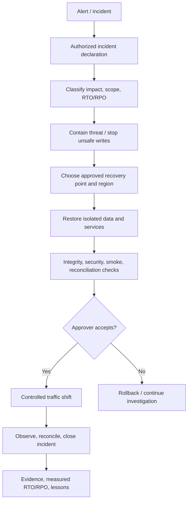

# Disaster recovery architecture

**Purpose/scope:** target recovery workflow; not implemented or exercised. Proposed RTO/RPO in DR-001 (4 h/15 min) require stakeholder approval and feasibility/cost testing.

Recover from immutable encrypted backups and documented infrastructure, not untested snapshots alone. Define recovery roles, separation of duties, backup retention, keys, provider dependencies, data loss communication, and isolated restore tests. Validate last known-good point, integrity, application compatibility and authorized cutover. Abuse risks include ransomware deletion of backups, forged recovery requests, and stale-data rollback; use MFA, immutable retention, scoped roles and dual approval. No recovery has been performed; target architecture alone does not meet RTO/RPO.
