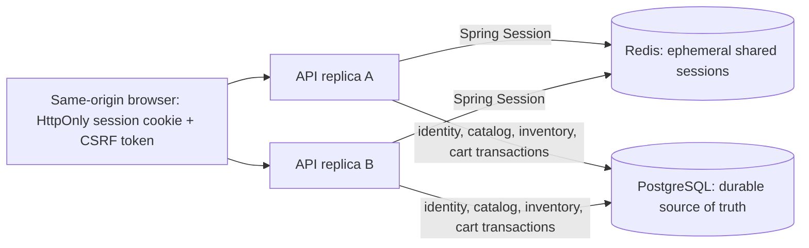

# Distributed sessions and persistent customer cart

**Status:** Phase 4 implementation on `feature/phase-4-distributed-state-cart`. This local design does not claim production HA.

## State ownership

PostgreSQL owns account/catalog/inventory/cart data. Redis owns only shared HTTP session records. There is no Redis cart cache and no fallback to process-local sessions.

## Session contract

- Boot-managed Spring Session Data Redis; Redis connection, password, namespace and timeout are configured through environment properties.
- Namespace defaults to `cloudresilience:sessions`; Redis connect/read timeouts default to two seconds; idle expiry defaults to 30 minutes.
- `JSESSIONID`: HttpOnly, SameSite=Lax, path `/`, Secure controlled by `APP_SECURITY_COOKIE_SECURE` (false only in local HTTP).
- Login preserves `ChangeSessionIdAuthenticationStrategy`; the security context is saved in shared Redis; logout invalidates the shared record. Jackson 3 serialization uses Spring Security modules and a restrictive polymorphic allowlist. The principal is serialized without its password hash or credentials; round-trip and rejection tests cover this configuration.
- Redis is private inside Compose. AOF volume supports local container restart but is not a backup or HA guarantee.
- Redis health is in readiness. Outage is fail-closed; no instance-local session is created.

## Cart persistence and locking

Flyway V3 creates `carts` and `cart_items`. A partial unique index enforces one ACTIVE cart per user. `(cart_id, product_id)` is unique and quantity is constrained to 1–9999. User/product foreign keys protect ownership/references. User identity is obtained only from the authenticated CUSTOMER principal.

Every mutation runs as a PostgreSQL transaction: `INSERT ... ON CONFLICT` creates-or-finds the unique active cart; `SELECT ... FOR UPDATE` locks it; a product-line operation and cart timestamp update follow. The cart lock serializes first-cart creation and all mutations for one customer; DB uniqueness is a final guard. No distributed lock/cache is involved.

`GET /api/v1/cart` and `/summary`; `POST /items` adds quantity to an existing product line; `PATCH /items/{itemId}` sets quantity; `DELETE /items/{itemId}` removes an owned line; `DELETE /items` clears lines while preserving the active cart. Missing and not-owned lines share 404 behavior.

Responses join current product price/status and current available quantity. Inactive lines remain visible. Add is rejected when product/category is inactive. Cart quantity can exceed stock; no inventory mutation/reservation/order/payment is performed. Checkout must revalidate price and availability.

See ADR-019–023, [API reference](../10-deployment/API_ENDPOINTS.md), and [security/session model](../05-security/AUTHENTICATION_AND_SESSIONS.md).
