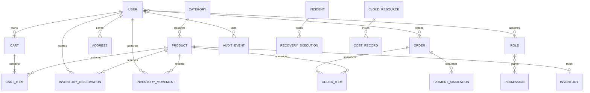

# Entity relationships

**Purpose/scope:** identity, catalog and inventory relationships are implemented through Flyway V1/V2; cart/order and resilience relationships remain conceptual. See [database design](DATABASE_DESIGN.md), [identity schema](IDENTITY_SCHEMA.md) and [catalog/inventory design](CATALOG_INVENTORY_DESIGN.md).

Addresses may be copied into a future order snapshot to preserve shipping history. The implemented category/product relationship is a single category FK (flat categories); inventory is one-to-one with product; reservation and movement rows reference product and actor. Cart/order/permission relationships above remain conceptual and need constraints when implemented. Product/category deletion is restricted where history could be referenced; inventory movements are append-only. Retention and anonymization decisions for future personal data remain deferred.
