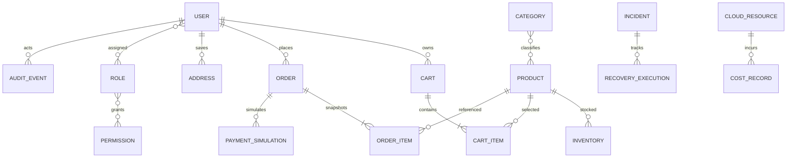

# Entity relationships

**Purpose/scope:** conceptual relationship map only; no deployed schema. See [database design](DATABASE_DESIGN.md).

Addresses may be copied into an order snapshot to preserve shipping history; avoid mutable address joins changing completed-order meaning. `USER`↔`ROLE`, `ROLE`↔`PERMISSION`, and `CATEGORY`↔`PRODUCT` need join entities/constraints. Decisions on cascade deletion, retention and anonymization remain deferred. Validation: compare each relationship with acceptance requirements before migrations.
