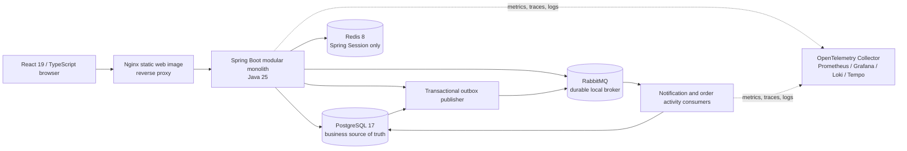

# CloudResilience final system architecture

**Status:** documents the repository implementation on `main`. It distinguishes local/CI behavior from the AWS target; it does not claim a cloud deployment.

## Runtime view

The modular monolith owns identity, catalog, inventory, carts, checkout, orders, payments and event consumers. PostgreSQL transactions atomically persist business state and outbox events. The publisher sends persistent messages to RabbitMQ with publisher confirms; consumers use the database inbox for idempotency. Delivery is at least once. Inventory reservation and checkout correctness remain synchronous and PostgreSQL-authoritative.

Redis stores shared HTTP sessions. It is not a cart, order or inventory source. Session loss requires customers to authenticate again; business records remain in PostgreSQL.

## Deployable boundary and portability

The local Compose environment supplies PostgreSQL, Redis, RabbitMQ, the API and static Nginx frontend. Optional observability services are local-only. Docker Compose integration tests run in hosted CI. Image and Terraform checks run in CI.

The AWS target is described in [AWS target architecture](AWS_TARGET_ARCHITECTURE.md) and Terraform modules. Terraform fmt, init without a backend, validate, TFLint and Checkov run in CI. No AWS resource, account-backed plan, or deployment was executed. Azure and Google Cloud are semantic mappings in [multi-cloud portability](MULTI_CLOUD_PORTABILITY.md), without provider infrastructure or adapters.

## State ownership and recovery

| State | Owner | Recovery behavior |
|---|---|---|
| Customers, products, inventory, carts, orders, payments | PostgreSQL | Custom-format backup and isolated restore scripts; synthetic order/payment restore passed in CI |
| Events and consumer idempotency | PostgreSQL outbox/inbox plus RabbitMQ delivery | Published events may be redelivered; consumers deduplicate by event and consumer |
| HTTP sessions | Redis | Session loss causes re-authentication; no business-state loss |
| Frontend/API binaries | Container build and CI artifacts | Rebuild from pinned project inputs; no production registry artifacts are claimed |
| Telemetry | Local observability stack | Operational signals; not a system of record |

See [final recovery summary](../12-disaster-recovery/FINAL_RECOVERY_SUMMARY.md) for the verified drill and open RTO/RPO/dependency tests.

## Guarantees and limits

- Order creation, payment simulation, inventory reservation and corresponding outbox writes are transactional within PostgreSQL boundaries.
- Messaging provides at-least-once delivery with idempotent consumers, not exactly-once processing.
- A CI recovery drill restored synthetic order/payment state into an isolated PostgreSQL database and passed consistency checks plus an API readiness/catalog smoke.
- No region failover, production recovery, external payment provider, or real customer workload was tested.
- SLOs and load results describe local targets and bounded tests; they are not production measurements.
