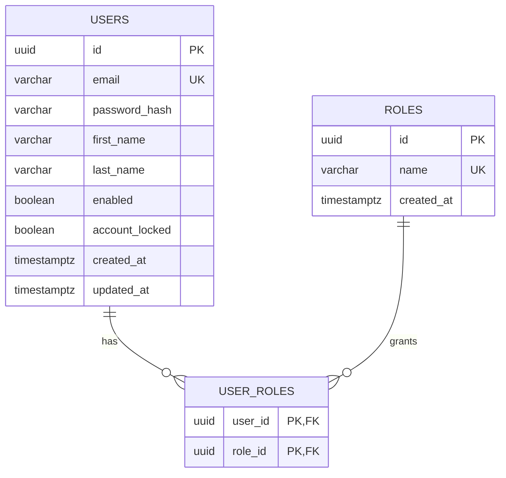

# Identity schema and persistence

**Scope:** first persisted customer/admin identity foundation. Catalog, inventory, carts, orders, payments and audit entities are future work. See [database model](DATABASE_DESIGN.md) and ADR-003/011/012.

## Entity relationship

Migration `apps/api/src/main/resources/db/migration/V1__create_identity_schema.sql` creates all tables, checks, FK constraints, unique indexes and two fixed role records. User UUIDv4 values are generated in the application; role UUIDs are stable migration data. Normalized email is trimmed/lower-cased in Java with `Locale.ROOT`, checked as normalized in PostgreSQL, and uniquely indexed. Timestamps are UTC `TIMESTAMPTZ`; JPA uses UTC and timestamp precision supported by PostgreSQL. Password hashes are never part of public response DTOs.

Flyway owns schema changes; migrations are immutable after application. Hibernate `ddl-auto=validate`, `open-in-view=false`. No default administrator or user row is seeded.

## Connection and readiness

The API reads `SPRING_DATASOURCE_URL`, `SPRING_DATASOURCE_USERNAME`, and `SPRING_DATASOURCE_PASSWORD`; Compose connects to the internal `postgres` service. Hikari's connection timeout is 5 seconds and JDBC connect/socket timeouts are 5/10 seconds. API `/api/v1/health` is an application/liveness signal; Actuator `/actuator/health/readiness` includes the database health contributor. Compose gates API health on database readiness, not Redis (the API does not use Redis yet). DB/cache host ports remain loopback-only.

## Later commerce additions

Add normalized commerce tables in subsequent forward migrations. Keep owner FKs, uniqueness and check constraints in PostgreSQL; decide retention/deletion requirements before collecting additional personal data.
