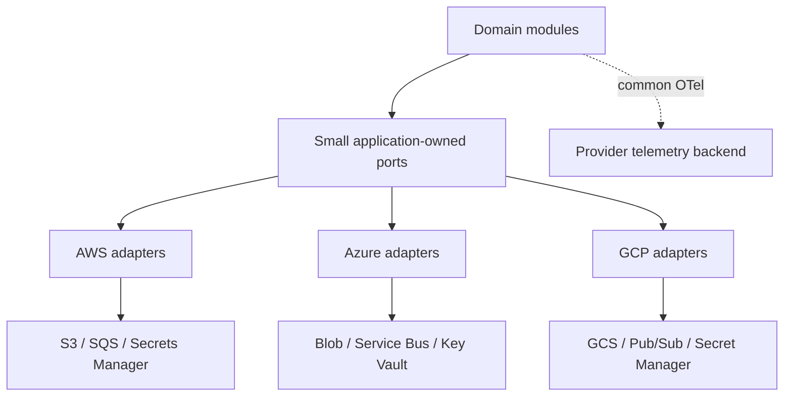

# Multi-cloud architecture

**Purpose/scope:** comparison and portability seams, not multi-cloud deployment. AWS is proposed primary; Azure/GCP are evaluated. See cloud service mapping/portability strategy and ADR-007.

Abstract object storage, message publishing, secret lookup, and coarse health where consumers truly need equivalent semantics. Preserve provider-specific capabilities (IAM, lifecycle policies, dead lettering, regional replication) in adapters/config, not a lowest-common-denominator framework. Test contracts with emulators/contract suites and provider implementations independently. Risks: differing delivery guarantees, IAM models, consistency, egress, regions, and billing undermine presumed portability. No adapters are implemented yet.
