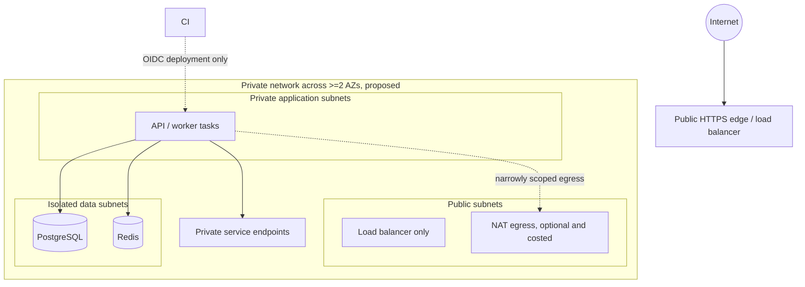

# Network architecture

**Purpose/scope:** planned production boundaries and local developer exceptions. There is no deployed VPC. Related: INF-002, SEC-003, deployment architecture.

Security groups are least-privilege: public inbound only TCP 443 to edge; edge to app listener; app to DB/cache exact ports; no Internet-sourced database access. Admin access uses SSO/MFA and audited controlled paths; no permanent SSH/bastion by default. Separate environments/accounts and restrict egress. Production DB is never publicly routable. Local Compose intentionally publishes developer ports only on loopback and its data network is marked internal. Validate with IaC policy, reachability tests and cloud security review.
