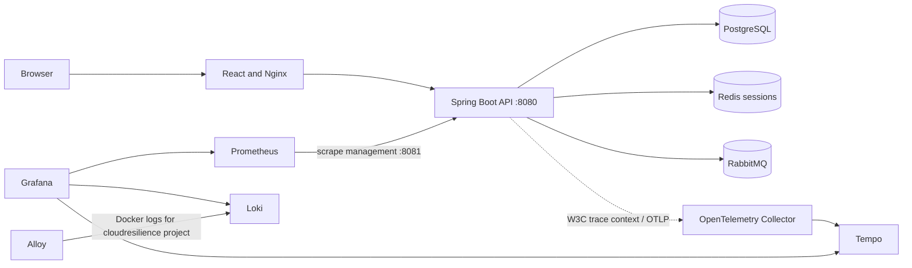

# Observability architecture

## Scope

This is the local observability profile for the CloudResilience modular monolith. It collects API metrics, traces, and container logs without making the observability services part of the public application edge. It is a development and engineering environment, not a production deployment claim.

## Signal flow



The application listener remains on port 8080. Actuator health and Prometheus endpoints use the separate management listener on port 8081 when Compose sets `MANAGEMENT_SERVER_PORT=8081`; the management port is not host-published. Prometheus reaches it on the internal observability network. The application port is published only on host loopback by the local Compose file. The default management-port setting remains 8080 for standalone development/tests.

The Spring Boot OpenTelemetry starter exports sampled traces by OTLP/HTTP to the Collector. Tracing export is disabled by default and can be enabled with `TRACING_EXPORT_OTLP_ENABLED=true`; Compose's `observability` profile sets it on for both API instances. Sampling probability is configurable and defaults to 0.1. W3C Trace Context and baggage propagation are configured. HTTP, scheduled task, JDBC/Micrometer and Spring AMQP observations are available according to the instrumentation present in the runtime. Spring AMQP template and listener observations are enabled so message operations can participate in tracing. API and scheduled-task traces were observed in local Tempo. A RabbitMQ integration test confirms that the publisher emits a W3C `traceparent` header. End-to-end consumer trace linking through every retry and DLQ replay path has not been independently verified.

Prometheus scrapes `/actuator/prometheus` on the management listener. Actuator exposes only health, info, and Prometheus; the `readiness` group covers readiness state, PostgreSQL, and Redis, while messaging health is a separate group. The API host port does not publish the management listener. Metrics use the static application tag and bounded outcome/state/consumer labels. Customer, order, session, and email identifiers are not metric labels.

Spring Boot structured console logs are collected by Alloy and sent to Loki. Alloy is configured to discover only containers with the Compose project label `cloudresilience`, to prevent ingestion of unrelated local projects. The development setup mounts the Docker Engine socket into Alloy; this is a sensitive host control surface even when mounted read-only. Run this profile only in a trusted local environment. A production deployment should replace this collection mechanism with a platform logging agent and least-privilege access.

Prometheus and Grafana join a dedicated local host-access network so their loopback-published ports work with Docker Desktop. The API and other observability services do not join that network. Loki uses a filtered data volume. The original local Loki volume from the pre-filter smoke run is preserved separately and is not mounted by the current profile.

## Components and local limits

All images are pinned in `compose.yaml`. Prometheus retains at most seven days or 2 GB, whichever limit is reached first. Loki is configured for a seven-day retention period. Tempo uses local filesystem storage with 24-hour block retention; this local profile does not configure a long-term trace retention guarantee. Grafana uses a named local volume and disables anonymous access and self-signup. Its port is bound to host loopback; set a strong local password through `GRAFANA_ADMIN_PASSWORD` in an untracked `.env` file. Example credentials in `observability.env.example` are placeholders and must not be used as deployment secrets.

Metrics, logs, and traces are not encrypted in transit inside the local Docker network. The profile is intended for local development, has no HA or multi-tenant isolation, and does not configure production access control, durable remote storage, or a production alert receiver. The Docker socket, local storage, and unauthenticated internal telemetry protocols are further reasons not to expose this network to untrusted hosts.

## Start and inspect

```powershell
Copy-Item .env.example .env
# Set a strong GRAFANA_ADMIN_PASSWORD in .env for local use.
docker compose --env-file observability.env.example --env-file .env --profile observability up -d --build
```

Grafana is available at `http://localhost:3000` and Prometheus at `http://localhost:9090`, both on loopback only. Tempo, Loki, and the Collector have no host-published ports. Grafana data sources and dashboard JSON are provisioned from `observability/grafana/`. Use Grafana Explore to query Prometheus, Loki, and Tempo. Logs can be searched with `{job="compose", service="api"}`. Prometheus targets and rules can be checked at `/targets` and `/rules`.

Stop the profile without deleting its data with:

```powershell
docker compose --env-file observability.env.example --env-file .env --profile observability down
```

`down` retains named volumes. Remove them only through a separately planned local data cleanup after exporting anything needed.

## Verification boundary

The profile was started locally. Prometheus reported the API scrape target healthy, API metrics were visible on the private management listener, the management path was unavailable on the host-published API port, and Tempo returned API traces. The local load test exercises catalog browsing only. These observations do not establish production capacity, a cloud SLO, or message-trace continuity for all event paths.
