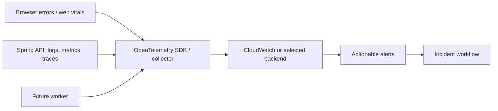

# Observability architecture

**Purpose/scope:** planned metrics/logs/traces; Phase 1 exposes only app/API local status. No cloud telemetry or SLO data currently exists.

Correlate requests with trace IDs; use structured logs and bounded-cardinality metrics. Never record credentials, tokens, card data, or unnecessary personal data. Define latency/error/saturation SLIs and alert ownership before adopting SLOs. Label provider, timestamp, sample window and simulated/live provenance. Retention and cost/cardinality controls are required. Validate sampling, redaction, time synchronization, alert runbooks and telemetry failure behavior. Risks: sensitive log leakage and monitoring cost.
