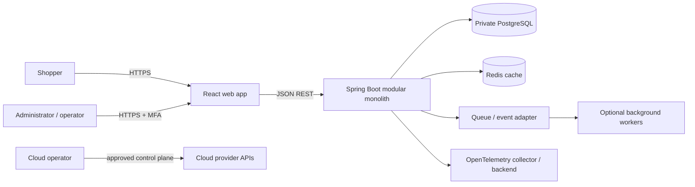
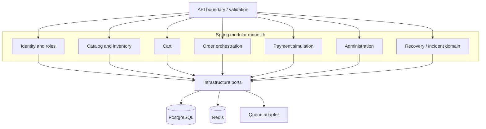
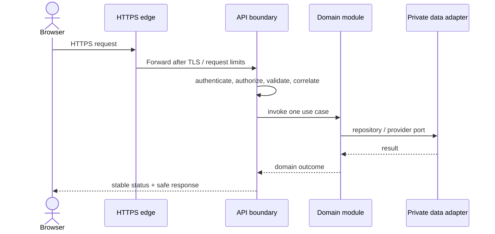
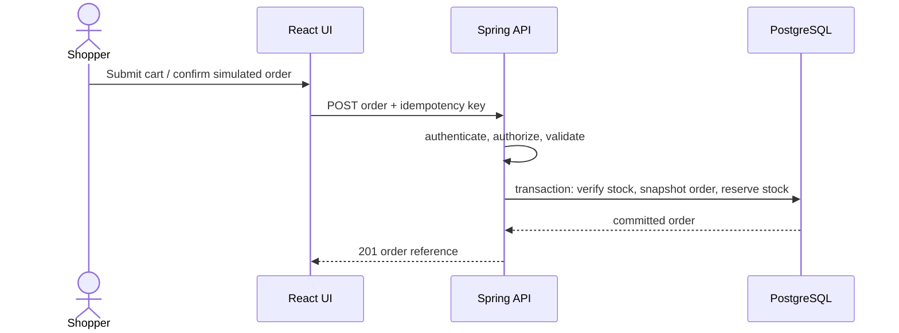
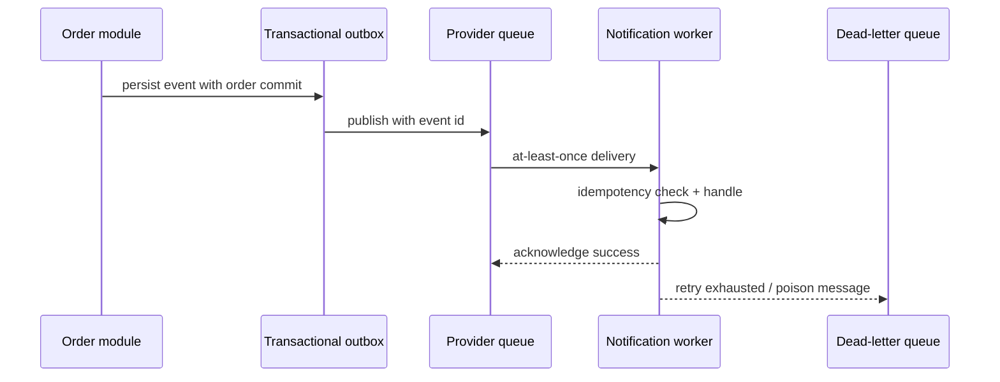

# System architecture

**Purpose/scope:** architectural baseline for the proposed commerce and resilience system. **Status:** target design; only the Phase 1 UI/API shell is being implemented. No cloud deployment exists. Related: [overview](ARCHITECTURE_OVERVIEW.md), ADRs, [security](../05-security/SECURITY_ARCHITECTURE.md), requirements.

## Context and containers

Implemented in Phase 1: local web shell; API health/info. Foundation: docs, local DB/cache Compose services, CI. Future: commerce modules, auth, workers, queue, cloud, telemetry and DR. Optional: Kubernetes only if deployment needs justify it.

## Module boundaries

Modules own behavior and data access; avoid direct cross-module table writes. Extract workers only for separately scaled/retried asynchronous tasks with a defined queue contract. Do not introduce distributed transactions for the initial order flow.

## Request, order, and async flows

Future asynchronous event lifecycle (not implemented):

**Security trust boundaries:** public browser/edge → authenticated API → private data plane; CI control plane → OIDC-scoped deployment identity (future); operator → audited recovery control plane. See [network architecture](NETWORK_ARCHITECTURE.md).

## Quality attributes, risks, validation

Stateless API supports horizontal scaling; PostgreSQL remains transactional source of truth; Redis is disposable cache, never sole durable data. Risks include modular boundary erosion, event duplication, cloud lock-in, and unvalidated RTO. Validate modules with tests, integration with compose/Testcontainers, and recovery through timed restore drills. Proposed latency and SLO targets are in NFRs, not measured results.
