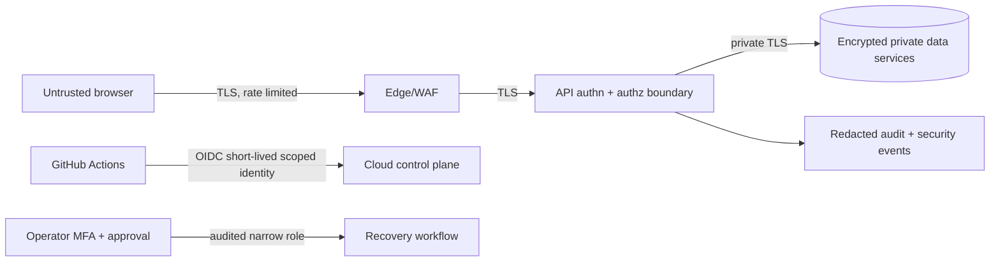

# Security architecture

**Purpose/scope:** security boundaries and controls for target architecture. Phase 1 has no production identity or cloud deployment. Related: [threat model](THREAT_MODEL.md), baseline, IAM, secrets design, SEC-001–006.

Authentication verifies identity; authorization is enforced per operation and object. Admin access requires MFA and separate role. Production transport uses TLS and storage encryption with managed keys; DB has no public address. Validate input, bound requests, rate limit, redact logs, scan pinned dependencies/images/IaC, and review deployment provenance. Store no payment card information. CI receives read-only repo permissions except explicitly justified jobs and no cloud credentials until an approved OIDC workflow. Risks: controls remain design-level until implemented and tested. Validation: threat review, integration negative tests, static/dependency/image/IaC scans, IAM/network policy review.
